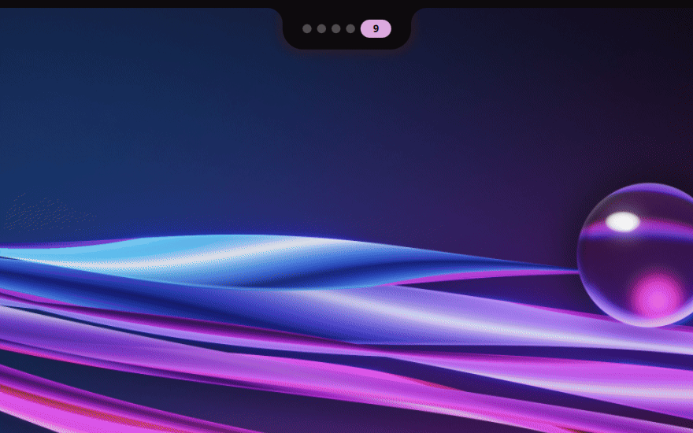
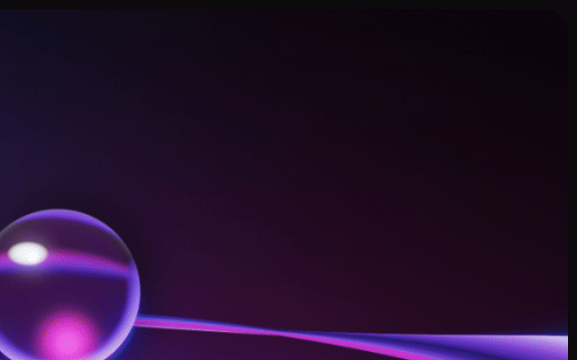
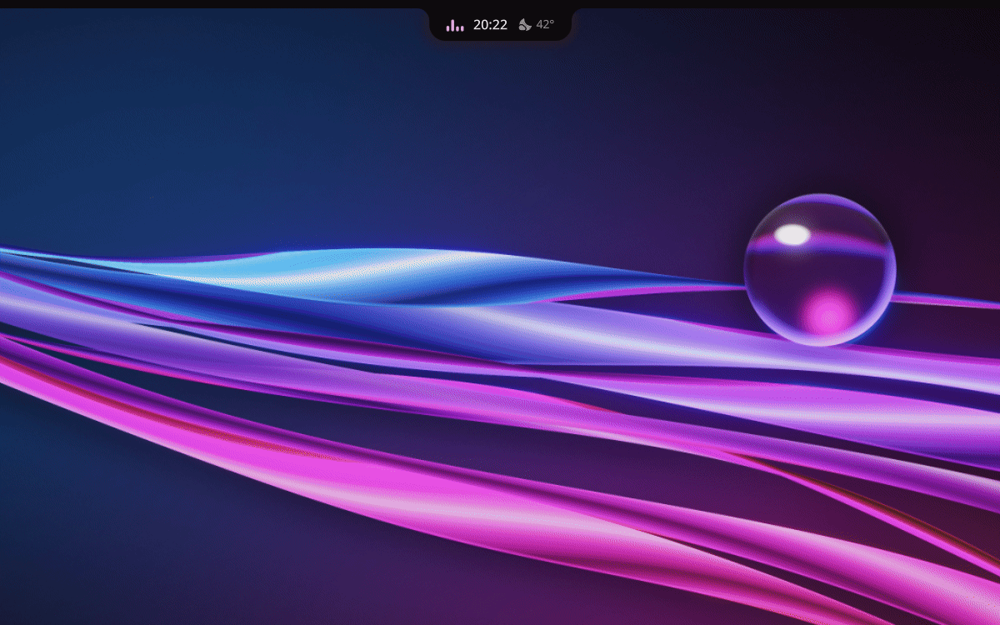
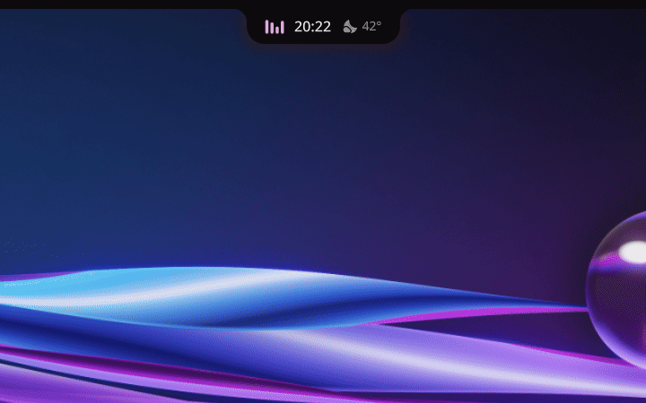
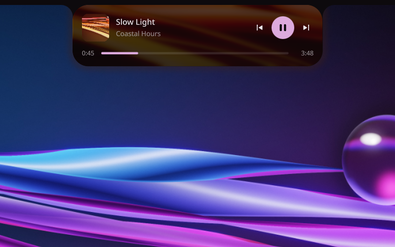
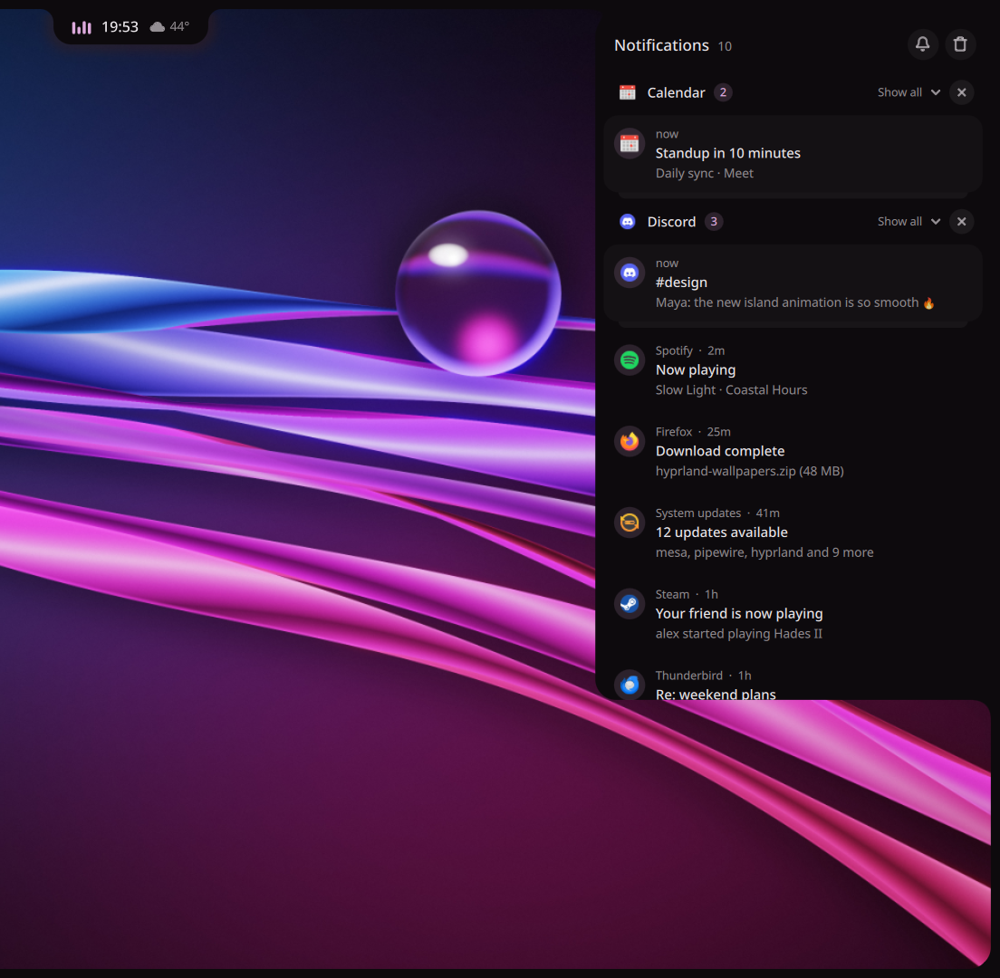
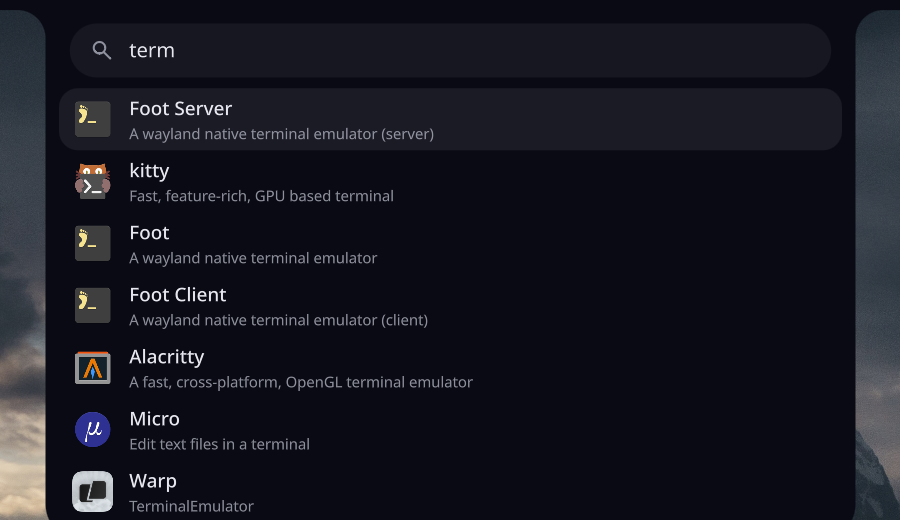

# bead

[](https://github.com/HamzaQaz/bead/actions/workflows/ci.yml)
[](CHANGELOG.md)

An opinionated desktop shell for [Hyprland](https://hyprland.org), built with
[Quickshell](https://quickshell.org). A bar, an island at the top of the
screen that grows into a launcher, a dashboard, a lock screen and
notifications. Everything morphs instead of popping, and it all takes its
colours from your wallpaper.

**[bead.n1ghtly.dev](https://bead.n1ghtly.dev)** has it in motion.

| | |
|---|---|
|  |  |
|  |  |


| | |
|---|---|
|  |  |
|  |  |
|  |  |

## Install

You need Arch or an Arch-based distro (CachyOS, EndeavourOS, Manjaro) and
Hyprland 0.57 or newer.

```sh
git clone https://github.com/HamzaQaz/bead && cd bead
./install.sh        # --tui for the terminal, --dry-run to look first
```

In a graphical session this opens an installer window. It shows every
package, download and file it will touch before it starts, and asks for
your password once (passed to sudo, never saved). Over SSH or with `--tui`
the same installer, **strand** (Go, Bubble Tea), runs in the terminal.
Packages come from pacman, or the AUR via `paru` or `yay`. Any file it edits
is backed up first as `*.bak-strand-<time>`.

Prefer a pacman package? Build it from this repo, then run `bead-setup` once
for keybinds and optional parts:

```sh
cd bead/packaging && makepkg -si && bead-setup
```

It goes on the AUR as `bead-shell-git` once registration reopens.

Start it with `bead start` or log in again. `bead doctor` (also in
Settings → About bead) lists anything missing and how to fix it.

`bead update` moves to the newest release and rolls back if the new one
won't start. A checkout with your own changes is left alone. `bead uninstall`
keeps your settings unless you add `--purge`.

## What's in it

- **Bar:** workspaces, tray, Wi-Fi, Bluetooth, sound, battery, clock.
- **Island:** music, timers, recordings, calls and toasts. Press
  <kbd>Super</kbd> and it's the launcher. Type to find apps, do maths
  (`5 usd to eur`), or use a prefix: `>` actions, `;` clipboard, `:` emoji,
  `/` files, `+` install apps (repos, Flathub, AUR), `?` ask Pearl.
- **Overview** (<kbd>Super</kbd>+<kbd>Tab</kbd>): every workspace, live.
  Drag windows between them. <kbd>↓</kbd> then <kbd>f</kbd> floats,
  <kbd>x</kbd> closes, <kbd>p</kbd> pins.
- **Dashboard** (<kbd>Super</kbd>+<kbd>K</kbd>): media, weather,
  performance, timers, wallpapers, installed apps and displays. Display
  changes undo themselves after 15 s unless you keep them.
- **Notifications** stack per app, swipe away, and keep a history.
- **Lock screen, OSDs** (volume, brightness including DDC, Caps Lock) and
  **Bluetooth** pairing from the bar. Sound follows your headphones.
- **Customise:** about 75 options for the island, pop-ups, bar and motion,
  with a live preview, presets, and looks you can share as a file.
- **Widgets:** a server, a CI run, a number from a URL, a toggle or any
  command, made in Settings and pinned to the island or the dashboard.
- **Shelf:** drop files on the island, drag them out into any app later.
  Screenshots, recordings and downloads offer themselves there for a moment.
- **Focus modes:** Work, Game, Night or your own. Each switches a look, Do
  Not Disturb, night light and wallpaper at once, by hand, on a schedule or
  while an app is open.

### Optional parts

Pick these in the installer.

| Part | |
|---|---|
| **Tint** | Colours from your wallpaper in OKLCH, so lightness looks even at any hue. Vibrant, muted or mono. |
| **Glint** | Toasts from the terminal, shown in the island: `glint success "Deployed"`, plus confirm, choose, and a spinner while a command runs. |
| **Glint for Claude Code** | Claude Code's permission prompts and questions become toasts you can answer. |
| **Murmur** | Voice, offline on your GPU (whisper.cpp plus a small Qwen model, about 1.2 GB). Hold <kbd>Super</kbd>+<kbd>Space</kbd>: "timer for ten minutes", "move Discord to 2", "what does this error mean?". Say "save that as focus" to make your own command. <kbd>Super</kbd>+<kbd>A</kbd> dictates. Questions about the screen go to Claude. |
| **Huddle** | Discord on the island: who's talking, mute, deafen, unread DMs. Needs your own Discord application, and the installer walks you through it. |
| **Pearl** | Answers questions from the launcher or by voice, using Claude Code, your Anthropic API key, or Murmur's model. |

## Keys

Written to `~/.config/hypr/bead.lua` (or `bead.conf`), and yours to edit.

| Keys | |
|---|---|
| <kbd>Super</kbd> | launcher |
| <kbd>Super</kbd>+<kbd>Tab</kbd> | overview |
| <kbd>Super</kbd>+<kbd>K</kbd> | dashboard |
| <kbd>Super</kbd>+<kbd>N</kbd> | notifications |
| <kbd>Super</kbd>+<kbd>L</kbd> | lock |
| <kbd>Super</kbd>+<kbd>V</kbd> / <kbd>Super</kbd>+<kbd>.</kbd> | clipboard / emoji |
| <kbd>Super</kbd>+<kbd>Shift</kbd>+<kbd>S</kbd> | screenshot an area |
| <kbd>Super</kbd>+<kbd>Shift</kbd>+<kbd>C</kbd> | colour picker |
| <kbd>Super</kbd>+<kbd>Alt</kbd>+<kbd>R</kbd> | record the screen |
| <kbd>Super</kbd>+<kbd>Space</kbd> (hold) | voice command |
| <kbd>Super</kbd>+<kbd>A</kbd> | dictate: tap for hands-free, hold to type on release |

Type `keys` in the launcher or run `bead keys` for the full list.

## Command line

```sh
bead start | stop | restart
bead settings [page]
bead dashboard toggle
bead lock
bead shot area
bead log                 # when something's off
bead doctor
bead voice list | run NAME | edit
```

Wallpapers go in `~/Pictures/Wallpapers`. Settings live in
`~/.config/bead/`. `BEAD_SCALE` overrides the UI size.

## Hacking on it

```
shell.qml     entry point
config/       theme, settings, customise schema
components/   shared pieces
modules/      bar, island, dashboard, lock, notifications, settings
services/     audio, media, weather, voice, focus modes, wallpapers
shaders/      the goo effects (qsb)
bin/          the bead CLI and its helpers
glint/        toast CLI and Claude Code hook (Go)
strand/       the installer (Go)
packaging/    the PKGBUILD
tests/        QML logic tests and script tests
docs/ideas/   the plan behind each round
```

`make install` installs the shell, `make test` runs the tests.
`make friend-test` installs bead on a fresh Arch in a podman container both
ways and checks it. CI runs that on every push.

## Credits

Made by [HamzaQaz](https://github.com/HamzaQaz) with
[Claude Code](https://claude.com/claude-code), on
[Quickshell](https://quickshell.org) and [Hyprland](https://hyprland.org).
Inspired by [Caelestia](https://github.com/caelestia-dots/shell).

GPL-3.0-or-later. See [LICENSE](LICENSE).
