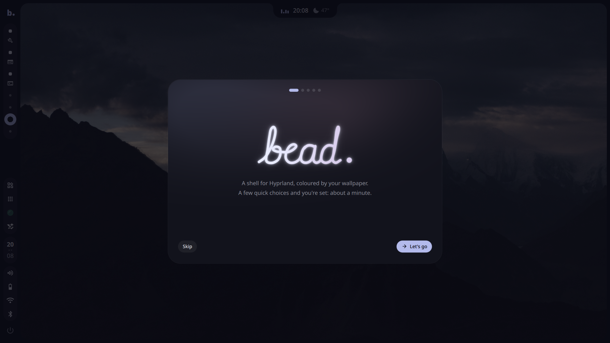
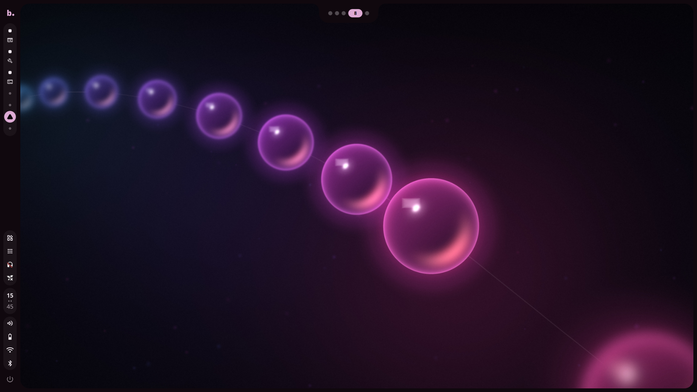
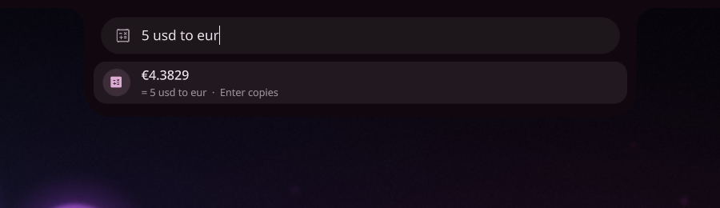

# bead

A desktop shell for [Hyprland](https://hyprland.org), built with
[Quickshell](https://quickshell.org). Soft pills that morph instead of pop:
a bar, an island at the top of the screen that grows into a launcher, a
dashboard, a lock screen and notifications, all coloured by your wallpaper.



| | |
|---|---|
|  |  |
|  |  |
|  |  |

## Install

Arch and Arch-based distros (CachyOS, EndeavourOS, Manjaro…) only.

```sh
git clone https://github.com/<you>/bead && cd bead
./install.sh            # or ./install.sh --dry-run to look around first
```

`install.sh` builds **strand**, a small installer (Go, Bubble Tea), and runs it.
strand checks what you have, lets you choose the optional parts, shows the
whole plan (packages, downloads, files it will touch), and only then
installs. Packages come from pacman, and from the AUR through `paru` or `yay`.
Any file strand edits gets backed up first (`*.bak-strand-<time>`).

Then start it with `bead start`, or log out and back in.

## What's in it

**The shell**
- **Bar**: workspaces, tray, Wi-Fi, Bluetooth, sound, battery, clock.
- **Island**: shows what's playing, timers, recordings, calls and toasts.
  Press <kbd>Super</kbd> and it becomes the launcher:
  - apps (the ones you launch most float up)
  - maths and units (`5 usd to eur`)
  - `>` actions (lock, power, timers)
  - `;` clipboard history
  - `:` emoji
  - `/` files
  - `?` questions for Pearl (see the optional parts below)
- **Overview** (<kbd>Super</kbd>+<kbd>Tab</kbd>): every workspace and its windows, live.
- **Dashboard** (<kbd>Super</kbd>+<kbd>K</kbd>): media, weather, performance, timers,
  wallpapers and settings.
- **Notifications**: grouped, swipe to dismiss, with history.
- **Lock screen**: PAM, with your wallpaper, the time and what's playing.
- **OSDs**: volume, brightness (including DDC monitors) and Caps Lock.

**Optional parts** (choose them in strand)

| Part | What it does |
|---|---|
| **Tint** | Builds bead's colours from your wallpaper, in OKLCH, so lightness steps look even whatever the hue. Three styles: vibrant, muted, mono. |
| **Glint** | Desktop toasts from the terminal: `glint success "Deployed"`, plus confirm, choose and promise (spinner while a command runs). They show inside bead's island. |
| **Glint for Claude Code** | Hooks that turn Claude Code's permission prompts, questions and "finished" messages into toasts you can answer. |
| **Murmur** | Voice. Hold <kbd>Super</kbd>+<kbd>Space</kbd> and say "timer for ten minutes", "open Steam on workspace 5 and close the rest", "move Discord to 2", "ssh into my server", "what does this error mean?" or "click the update button". "Undo" and "again" work on most of it. Add your own commands and chains of steps in `~/.config/bead/voice.json`. Tap <kbd>Super</kbd>+<kbd>A</kbd> to dictate hands-free (typed as you speak), or hold it and let go to type. Runs offline on your GPU (whisper.cpp and a small Qwen model, about 1.2 GB); questions about your screen and clicks go to Claude. |
| **Huddle** | Discord on the island: who's talking, mute and deafen, unread DMs. Needs a Discord application of your own; strand explains how to set one up. |
| **Pearl** | Answers questions from the launcher (`?`) or by voice. It can use Claude Code, your own Anthropic API key, or Murmur's local model. |

## Keys

strand writes these into `~/.config/hypr/bead.lua` (or `bead.conf`). They're
yours to edit.

| Keys | |
|---|---|
| <kbd>Super</kbd> | launcher |
| <kbd>Super</kbd>+<kbd>Tab</kbd> | overview |
| <kbd>Super</kbd>+<kbd>K</kbd> | dashboard |
| <kbd>Super</kbd>+<kbd>N</kbd> | notifications |
| <kbd>Super</kbd>+<kbd>L</kbd> | lock |
| <kbd>Super</kbd>+<kbd>V</kbd> / <kbd>Super</kbd>+<kbd>.</kbd> | clipboard / emoji |
| <kbd>Super</kbd>+<kbd>Shift</kbd>+<kbd>S</kbd> | screenshot an area |
| <kbd>Super</kbd>+<kbd>Shift</kbd>+<kbd>C</kbd> | colour picker |
| <kbd>Super</kbd>+<kbd>Alt</kbd>+<kbd>R</kbd> | record the screen |
| <kbd>Super</kbd>+<kbd>Space</kbd> (hold) | voice command (Murmur) |
| <kbd>Super</kbd>+<kbd>A</kbd> | dictate (Murmur): tap for hands-free, hold to type on release |

## Using it

```sh
bead start | stop | restart
bead dashboard toggle
bead lock
bead shot area
bead log                  # the shell's log, for when something's off
bead voice list | run NAME | edit   # your voice commands
```

- Wallpapers live in `~/Pictures/Wallpapers`. Pick one from the dashboard.
- Settings live in the dashboard's Settings tab. They're saved to `~/.config/bead/settings.json`.
- `BEAD_SCALE` sets the UI scale (default `1.35`).

## Layout

```
shell.qml        entry point
config/          theme, settings
components/      shared pieces (icons, the play/pause morph…)
modules/         bar, island, dashboard, lock, notifications, background
services/        audio, media, weather, voice, Pearl (Ask.qml), wallpapers…
shaders/         the goo / blob effects (built with qsb)
bin/             bead (the CLI), bead-tint, bead-pearl, bead-dictate, bead-discord
glint/           the toast CLI (Go) and its Claude Code hook
strand/          the installer (Go, Bubble Tea)
tools/           the handwriting generator, screenshots.sh (these README pictures)
docs/            the screenshots
```

To build by hand: `make install` (the shell), `make install-glint`, and `make test`.

## Licence

GPL-3.0-or-later. See [LICENSE](LICENSE).
