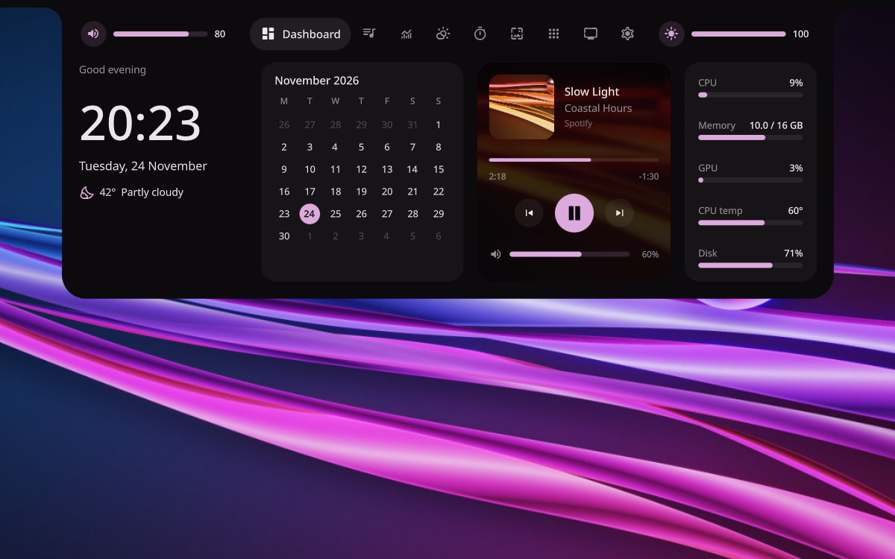
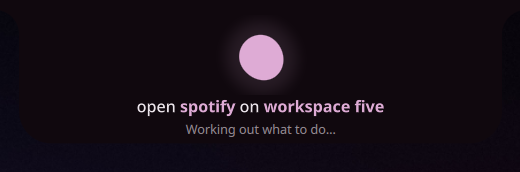

# bead

[](https://github.com/HamzaQaz/bead/actions/workflows/ci.yml)
[](CHANGELOG.md)

A desktop shell for [Hyprland](https://hyprland.org), built with
[Quickshell](https://quickshell.org). Soft pills that morph instead of pop:
a bar, an island at the top of the screen that grows into a launcher, a
dashboard, a lock screen and notifications, all coloured by your wallpaper.


| | |
|---|---|
|  |  |
|  |  |
|  |  |

## Install

Arch and Arch-based distros (CachyOS, EndeavourOS, Manjaro…) on
Hyprland 0.57 or newer (the Lua config).

```sh
git clone https://github.com/HamzaQaz/bead && cd bead
./install.sh            # a window in a graphical session; --tui for the terminal, --dry-run to look around
```

Or as a pacman package, built from the PKGBUILD in this repo, then
`bead-setup` once for your keybinds and the optional parts:

```sh
git clone https://github.com/HamzaQaz/bead && cd bead/packaging
makepkg -si && bead-setup
```

The same package is coming to the AUR as `bead-shell-git` (`paru -S
bead-shell-git`) once AUR registration reopens.

In a graphical session `install.sh` installs Quickshell first, then opens
bead's installer as a window: welcome, choose the parts, review, your
password once (handed to sudo, never saved), then live progress. Underneath,
and in a terminal (`--tui`, over SSH, `--yes`), it's **strand**, a small
installer (Go, Bubble Tea). strand checks what you have, lets you choose the optional parts, shows the
whole plan (packages, downloads, files it will touch), and only then
installs. Packages come from pacman, and from the AUR through `paru` or `yay`.
Any file strand edits gets backed up first (`*.bak-strand-<time>`).

Then start it with `bead start`, or log out and back in. If something
doesn't work, `bead doctor` lists what's missing and how to fix it (the same
check is in Settings → About bead).

### Keeping it up to date, or taking it off

```sh
bead update              # the newest release, with what's new (CHANGELOG.md)
bead uninstall           # keeps your settings; --purge takes those too, --dry-run only lists
```

`bead update` moves a git checkout to the newest release and reinstalls; if
the new bead won't start, the old one comes back. It leaves a checkout with
changes of its own alone. A package install updates by building it again (`makepkg -si` in
`packaging/`), or with `paru -Syu` once it's on the AUR. Settings →
System says when a new release is out.

## What's in it

**The shell**
- **Bar**: workspaces, tray, Wi-Fi, Bluetooth, sound, battery, clock.
- **Island**: shows what's playing, timers, recordings, calls and toasts.
  Press <kbd>Super</kbd> and it becomes the launcher:
  - apps (the ones you launch most float up)
  - maths and units (`5 usd to eur`)
  - `>` actions (lock, power, timers)
  - `;` clipboard history
  - `:` emoji
  - `/` files
  - `+` install apps from the repos, Flathub and the AUR (AUR builds open in a
    terminal, so you see the build file first)
  - `?` questions for Pearl (see the optional parts below)
- **Overview** (<kbd>Super</kbd>+<kbd>Tab</kbd>): every workspace and its windows, live.
  Drag a window to another workspace (or onto `+` for a new one); <kbd>↓</kbd> picks a
  window, then <kbd>f</kbd> floats, <kbd>x</kbd> closes and <kbd>p</kbd> pins it.
- **Dashboard** (<kbd>Super</kbd>+<kbd>K</kbd>): media, weather, performance, timers,
  wallpapers (bead's own included), apps (sizes, last opened, uninstall, updates),
  displays (drag to arrange; refresh rate, scale, rotation, each change undone
  after 15 s unless you keep it) and settings. Opened by
  key, it's all reachable by keyboard: number keys for tabs, arrows to move.
- **Notifications**: one app's pop-ups stack into one, swipe to dismiss, with history.
- **Lock screen**: PAM, with your wallpaper, the time and what's playing.
- **OSDs**: volume, brightness (including DDC monitors) and Caps Lock.
- **Bluetooth**: pairs new devices from the bar; sound follows headphones when
  they connect and comes back when they go.

**Optional parts** (choose them in strand)

| Part | What it does |
|---|---|
| **Tint** | Builds bead's colours from your wallpaper, in OKLCH, so lightness steps look even whatever the hue. Three styles: vibrant, muted, mono. |
| **Glint** | Desktop toasts from the terminal: `glint success "Deployed"`, plus confirm, choose and promise (spinner while a command runs). They show inside bead's island. |
| **Glint for Claude Code** | Hooks that turn Claude Code's permission prompts, questions and "finished" messages into toasts you can answer. |
| **Murmur** | Voice. Hold <kbd>Super</kbd>+<kbd>Space</kbd> and say "timer for ten minutes", "open Steam on workspace 5 and close the rest", "move Discord to 2", "ssh into my server", "what does this error mean?" or "click the update button". "Undo" and "again" work on most of it. Teach it your own: after a command or a few, say "save that as focus" (or "save the last three as focus"), then just say "focus"; "forget focus" removes it. They're listed in the launcher under `>` too, and live in `~/.config/bead/voice.json` for editing by hand. Tap <kbd>Super</kbd>+<kbd>A</kbd> to dictate hands-free (typed as you speak), or hold it and let go to type. Runs offline on your GPU (whisper.cpp and a small Qwen model, about 1.2 GB); questions about your screen and clicks go to Claude. |
| **Huddle** | Discord on the island: who's talking, mute and deafen, unread DMs. Needs a Discord application of your own; strand explains how to set one up. |
| **Pearl** | Answers questions from the launcher (`?`) or by voice. It can use Claude Code, your own Anthropic API key, or Murmur's local model. |

## Keys

strand writes these into `~/.config/hypr/bead.lua` (or `bead.conf`). They're
yours to edit.

| Keys | |
|---|---|
| <kbd>Super</kbd> | launcher |
| <kbd>Super</kbd>+<kbd>Tab</kbd> | overview |
| <kbd>Super</kbd>+<kbd>K</kbd> | dashboard |
| <kbd>Super</kbd>+<kbd>N</kbd> | notifications |
| <kbd>Super</kbd>+<kbd>L</kbd> | lock |
| <kbd>Super</kbd>+<kbd>V</kbd> / <kbd>Super</kbd>+<kbd>.</kbd> | clipboard / emoji |
| <kbd>Super</kbd>+<kbd>Shift</kbd>+<kbd>S</kbd> | screenshot an area |
| <kbd>Super</kbd>+<kbd>Shift</kbd>+<kbd>C</kbd> | colour picker |
| <kbd>Super</kbd>+<kbd>Alt</kbd>+<kbd>R</kbd> | record the screen |
| <kbd>Super</kbd>+<kbd>Space</kbd> (hold) | voice command (Murmur) |
| <kbd>Super</kbd>+<kbd>A</kbd> | dictate (Murmur): tap for hands-free, hold to type on release |

The same list is in bead itself: type `keys` (or `#`) in the launcher, or run `bead keys`. In the launcher, <kbd>Tab</kbd> on an app, window or file shows what you can do with it; in the clipboard list, <kbd>Ctrl</kbd>+<kbd>S</kbd> pins an entry so it stays on top. A notification's **Later** button sends it away for 20 minutes, an hour or until tomorrow morning.

## Using it

```sh
bead start | stop | restart
bead dashboard toggle
bead lock
bead shot area
bead log                  # the shell's log, for when something's off
bead doctor               # what bead needs, and what's missing
bead version
bead voice list | run NAME | edit   # your voice commands
```

- Wallpapers live in `~/Pictures/Wallpapers`. Pick one from the dashboard.
- Settings have their own window: the launcher ("settings"), the dashboard, or `bead settings [page]`. They're saved to `~/.config/bead/settings.json`.
- `BEAD_SCALE` sets the UI scale (Settings → Appearance → Size otherwise).

## Layout

```
shell.qml        entry point
config/          theme, settings
components/      shared pieces (icons, the play/pause morph…)
modules/         bar, island, dashboard, lock, notifications, background
services/        audio, media, weather, voice, Pearl (Ask.qml), wallpapers…
shaders/         the goo / blob effects (built with qsb)
bin/             bead (the CLI), bead-doctor, bead-update, bead-uninstall, bead-tint, bead-pearl…
glint/           the toast CLI (Go) and its Claude Code hook
strand/          the installer (Go, Bubble Tea)
tools/           screenshots.sh (these README pictures), make-wallpaper.py (bead's wallpapers)
packaging/       the AUR package (bead-shell-git)
tests/           QML logic tests, the script test, and the friend test
docs/            the screenshots, and the plans behind each round (docs/ideas)
```

To build by hand: `make install` (the shell), `make install-glint`, and
`make test`. `make friend-test` installs bead on a fresh Arch in a throwaway
podman container, both with `./install.sh` and as the package, and checks it;
CI runs the same on every push.

## Licence

GPL-3.0-or-later. See [LICENSE](LICENSE).
